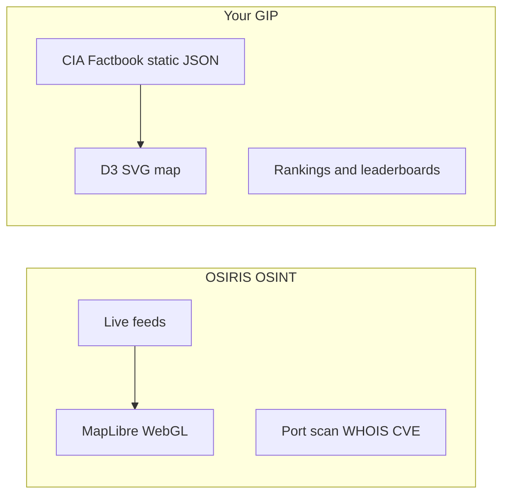
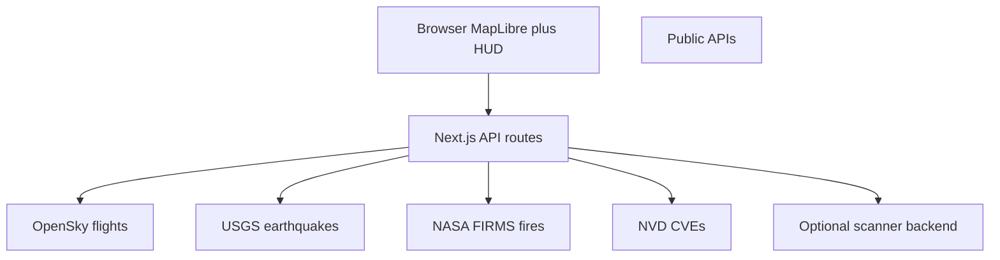
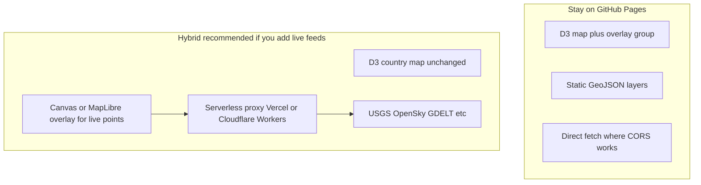

# OSIRIS.ai Research and GIP Integration Path

## What you found (and what it is not)

The site NordVPN likely flagged is **OSIRIS** — an open-source **real-time OSINT dashboard**, not a traditional malware site.

| Item | Detail |
|------|--------|
| Live site | [osirisai.live](https://osirisai.live) (README also references [osirislive.app](https://osirislive.app)) |
| GitHub | [github.com/simplifaisoul/osiris](https://github.com/simplifaisoul/osiris) — MIT license, ~6K stars, TypeScript/Next.js 16 |
| Tagline | "Open Source Palantir alternative" — situational awareness, not country encyclopedia |

**Not the same thing:** [osirisai.com](https://osirisai.com) is an unrelated **drone operating system**. Same name, different product.



---

## Is the NordVPN / malware flag legit?

**Probably a reputation false positive, not proof the code is malicious** — but treat the *hosted* site cautiously until you verify it yourself.

Why security tools flag it:

1. **Very new domain** — registered ~May 2026; reputation engines punish young domains heavily (Gridinsoft, VirusTotal partners, etc. score it ~21–24/100).
2. **Dual-use tooling** — built-in **port scanner, WHOIS, IP intel, CVE lookup** look like "hacking tools" to automated classifiers even when used defensively.
3. **Aggressive marketing** — "Palantir alternative," crypto wallet tracing, Telegram OSINT, Patreon "RedTeam Console" — reads like hype/scam patterns to heuristics.
4. **Third-party hosting** — you are trusting whoever runs `osirisai.live`, not just the GitHub source.

**Safe way to explore:**

- Clone and run **from GitHub only**: `git clone https://github.com/simplifaisoul/osiris.git`
- Read source before running; use Docker (`docker compose up -d`) or `npm run dev` locally
- **Do not** download executables, browser extensions, or "special console" builds from Discord/Patreon/crypto links
- The MIT repo is auditable; the public deployment is what VPNs are blocking

---

## How OSIRIS differs from your project

Your [ARCHITECTURE.md](ARCHITECTURE.md) describes a **client-side Factbook explorer**. OSIRIS is a **live intelligence operations board**. They share a map; they do not share a product goal.

| Dimension | Your GIP | OSIRIS |
|-----------|----------|--------|
| Data | Static CIA Factbook JSON per country | 16+ live layers (flights, CCTV, quakes, fires, news, satellites, etc.) |
| Map engine | D3.js + TopoJSON (SVG) | MapLibre GL (WebGL, 60fps for thousands of entities) |
| Backend | None — GitHub Pages | Next.js API routes proxy external feeds |
| User goal | Compare countries, rankings, profiles | Monitor world events in real time |
| "Intelligence" | Composite influence scores | OSINT recon toolkit (DNS, WHOIS, port scan) |

**"Better" depends on what you want.** OSIRIS is stronger for *live situational awareness*. Your portal is stronger for *structured country comparison and Factbook depth*. OSIRIS does not replace Factbook rankings; your portal does not show 10,000 live aircraft.

---

## What OSIRIS does technically (the parts worth learning from)

From the [OSIRIS README](https://github.com/simplifaisoul/osiris):



Patterns worth borrowing:

- **Layer toggles** — each feed is on-demand; `layerFetchedRef` avoids duplicate fetches
- **API route proxy** — solves CORS and hides API keys (OpenSky now needs OAuth2)
- **Viewport-aware loading** — only fetch data for visible map bounds
- **Progressive polling** — 15–30 min intervals for stable data vs constant hammering

Patterns that are a poor fit for GIP:

- Port scanner / WHOIS / wallet tracing — different audience, legal/hosting risk, needs backend
- 2,000+ CCTV streams — heavy proxy infra, not Factbook-adjacent
- Full MapLibre migration — large rewrite for marginal gain unless you need thousands of moving points

---

## Recommended path for you (understand + cherry-pick + stack guidance)

You selected: understand first, add real-time layers later, cherry-pick specific features, stack TBD.

### Phase 0 — Understand safely (no GIP changes)

1. Clone [simplifaisoul/osiris](https://github.com/simplifaisoul/osiris) into a separate folder (not inside GIP).
2. Run locally with `npm install && npm run dev` or Docker.
3. Toggle layers and note which APIs each uses (check `app/api/` routes in their repo).
4. Decide which 1–2 layers actually complement Factbook data.

### Phase 1 — Cherry-pick candidates (best fit for GIP)

Ranked by alignment with your project and feasibility on [GitHub Pages](https://pages.github.com):

| Feature | Fit with GIP | Client-only? | Effort |
|---------|--------------|--------------|--------|
| **USGS earthquakes (M2.5+)** | High — geo events on your map | Maybe — USGS GeoJSON may allow direct fetch; test CORS first | Low |
| **Static conflict/tension zones** | High — contextualizes country selection | Yes — ship GeoJSON, toggle layer on D3 map | Low |
| **NASA EONET severe weather** | Medium — complements geography | Likely needs proxy | Medium |
| **GDELT / news event dots** | Medium — "what's happening here" | Needs proxy | Medium |
| **OpenSky flights** | Low–medium — cool but noisy | No — OAuth2 + rate limits need server | High |
| **CCTV / live news streams** | Low — different product | No | High |
| **RECON toolkit** | Poor fit for Factbook portal | No | High + risk |

**Suggested first picks:** earthquakes + conflict zones. They add "what's happening on the map" without fighting your D3 architecture or requiring a full backend on day one.

### Phase 2 — Architecture decision (stack recommendation)



**Recommendation:** stay **client-side for Phase 1** (static + earthquakes if CORS works). When you add flights, news, or anything key-gated, add a **thin serverless proxy** (Vercel serverless functions or Cloudflare Workers) — same pattern OSIRIS uses, but you do not need to migrate to Next.js.

**Do not** try to replicate OSIRIS's WebGL performance inside D3 SVG for thousands of aircraft. If you later need that scale, add a **canvas/WebGL overlay** on top of your existing map rather than replacing D3 entirely.

### Phase 3 — Implementation sketch in GIP (when you approve build)

Target files in your repo:

- New module: [`js/utils/liveLayers/`](js/utils/liveLayers/) — fetch, normalize, poll per layer
- Map overlay: extend [`js/map.js`](js/map.js) with a `live-overlay` SVG group or sibling `<canvas>`
- UI toggles: layer panel in existing layout CSS ([`css-styles/`](css-styles/))
- Optional proxy: separate small Vercel/Workers project if CORS blocks client fetch

Pseudocode flow:

```javascript
// js/utils/liveLayers/earthquakes.js
export async function fetchRecentQuakes() {
  const res = await fetch(USGS_URL); // or /api/earthquakes if proxied
  return res.json().features.map(normalizeQuake);
}

// js/map.js — add overlay circles, don't touch country paths
export function renderLiveLayer(layerId, points) { ... }
```

State: extend [`js/state.js`](js/state.js) with `activeLiveLayers` and polling intervals.

---

## What "doing the same" does NOT mean

- **Not required:** fork OSIRIS wholesale, adopt Next.js, or rebuild as OSINT
- **Not recommended:** port scanner / wallet tracing into a public Factbook site
- **Not realistic on GitHub Pages alone:** full flight + CCTV + news stack without any backend

**Reasonable interpretation:** GIP becomes a **Factbook-first global map** with **optional live context layers** (events, quakes, zones) — your differentiator stays rankings and country depth; OSIRIS-inspired pieces add timeliness.

---

## Open question for next step

When you are ready to build, tell Gee which cherry-picks you want first (e.g. "earthquakes + conflict zones only"). Phase 0 local OSIRIS exploration can happen in parallel and does not require GIP changes.
