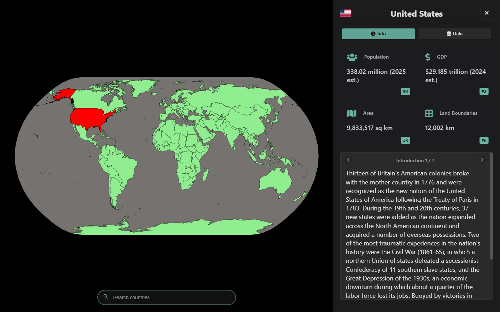

# Global Information Portal

An interactive world map that turns CIA World Factbook data for 240+ countries and territories into clickable statistics, regional rankings, and a composite influence leaderboard, built for students, educators, travelers, and anyone comparing how countries stack up.

**Live site:** https://kcpatt27.github.io/global-info-portal/

**Repository:** https://github.com/kcpatt27/global-info-portal

---

## Screenshots

All three were captured on 2026-11-17 from a production build of this branch, at 1440x900, with the United States selected.

### Map and country info



Click a country to highlight it and load its flag, quick stats, and background text. The Info and Data buttons switch the sidebar between the summary and the full Factbook tree.

### Global Superpower Leaderboard


The Rankings tab scores countries on People, Money, Reach, Resources, and Quality, then ranks them by a combined Influence Scale.

### Statistics


The Statistics tab loads the full Factbook category tree for the selected country, with per-category counts, search, and expandable entries.

---

## How the data pipeline works

Everything runs in the browser. There is no backend, no database, and no API key.

1. **Map geometry.** On load, `js/map.js` fetches a TopoJSON world atlas and a TSV of country rows from `kcpatt27/world-atlas-2-world-factbook` on GitHub, converts the TopoJSON to GeoJSON with `topojson.feature`, and renders it as SVG with D3.
2. **Country selection.** Clicking a country resolves its Factbook folder. `getSpecialFolder` handles codes whose folder is not the continent name, and `determineFolder` falls back to the continent slug.
3. **Factbook fetch.** `js/utils/dataFetcher.js` requests `https://raw.githubusercontent.com/factbook/factbook.json/master/{folder}/{a2}.json`. It deduplicates in-flight requests, aborts after 10 seconds, and retries against a `/factbook/{folder}/{a2}.json` fallback path if the first URL fails.
4. **Parsing.** `extractDataPoint` walks dot-notation paths and unwraps the Factbook's `{ text: ... }` values. `processText` strips HTML. `detectTimeSeriesData` finds year-keyed series so trends can be charted.
5. **Leaderboard pre-cache.** `js/utils/globalPreCache.js` loads 50 priority countries in batches of 5 with a 100 ms gap, then starts secondary countries 2 seconds later. It keeps only the metrics the leaderboard needs, stores them in `localStorage` under a versioned key (version 15, 7-day expiry), and feeds `globalDataIndex`.
6. **Scoring.** `js/utils/leaderboardScoring.js` normalizes each metric against fixed reference scales (log, linear, higher-is-better, lower-is-better, and optimal-range), so a country's score does not change as more countries load. The five category scores sum into the Influence Scale shown in the Rankings tab.
7. **Rendering.** `js/panels/` and `js/components/` draw the Info, Statistics, and Rankings panels, plus spider charts and category bars.

Two known data quirks, both visible in the code: Factbook codes are FIPS-style, not ISO, so a few countries do not appear on the leaderboard until they are clicked (see the comment above `PRIORITY_COUNTRIES` in `js/utils/globalPreCache.js`), and some territories have incomplete Factbook entries.

---

## Build and run locally

Requires Node.js and npm. The commands below were run on Node v24.18.0 and npm 11.16.0.

```bash
git clone https://github.com/kcpatt27/global-info-portal.git
cd global-info-portal
npm install
npm run build
```

`npm run build` writes the production bundles to `dist/`. The root `index.html` loads `dist/runtime.js`, `dist/vendors.js`, `dist/main.js`, and `dist/styles.css`, so serve the repository root, not `dist/`:

```bash
python -m http.server 8010
```

Then open http://localhost:8010. Any static file server works; the app only needs the repo root.

### About `npm start` and `npm run deploy`

`npm start` does not work in this repo. It runs `webpack serve --mode development`, but the `@webpack-cli/serve` package is not installed, so webpack-cli prints `No commands found to run` and exits with code 1. Use the `python -m http.server` route above.

`npm run deploy` is not a real deploy. It runs the build and then prints a reminder to commit and push `dist/`.

---

## Deploy to GitHub Pages

GitHub Pages serves the `main` branch at the repository root, and the built `dist/` directory is committed. Deploying means rebuilding it and pushing to `main`:

```bash
npm run build
git add dist
git commit -m "build: rebuild dist for GitHub Pages"
git push origin main
```

`npm run build` and `git add dist` were run here. The `git commit` and `git push` steps were not executed during this documentation pass, because they publish to the live site. A fresh build can rewrite files under `dist/` (bundle contents and chunk names depend on the installed dependency versions), so expect a diff there.

The live site was checked on 2026-11-17: https://kcpatt27.github.io/global-info-portal/ returns 200 and serves `index.html` with `dist/main.js`, `dist/runtime.js`, `dist/vendors.js`, and `dist/styles.css`. The repository's Pages settings page was not inspected, so the branch and folder above are inferred from what the live site serves, not read from the settings.

---

## Where the `docs/` set fits

The README is the entry point. Deeper material lives in `docs/` and the root design docs:

- `ARCHITECTURE.md` - system design, module boundaries, and the data flow in more detail.
- `ROADMAP.md` - what is done, what is next, and the feature backlog.
- `PROJECT_SPECS.md` - the project vision and current status.
- `docs/key-metrics.md` - project metrics: build sizes, commit history, and measurement notes.
- `docs/retrospective.md` - the project timeline, what worked, and what would change next time.
- `docs/living-doc-of-build-process.md` - the build story in the author's own words.
- `docs/summary-for-career.md` - a career-facing summary of the project.
- `docs/gip-RESUME_DATA_POINTS.md` - resume-oriented data points.
- `docs/feature-planning/` - planning notes for mobile CSS, mobile navigation, and the Rankings tab.
- `docs/fix-refactor-planning/` - the JavaScript refactor plan and leaderboard metrics analysis.
- `memory-bank/` - agent-facing context: active context, progress, system patterns, and tech context.
- `tickets/` - the consolidation tickets this documentation pass started from.

Note: `ROADMAP.md`, `PROJECT_SPECS.md`, and `docs/gip-RESUME_DATA_POINTS.md` still link the old `global-information-portal` URL. The correct live site is https://kcpatt27.github.io/global-info-portal/.

---

## License and data attribution

This project has no `LICENSE` file and is currently unlicensed, all rights reserved.

Country data comes from the **CIA World Factbook**, distributed through the `factbook/factbook.json` repository, which is licensed CC0-1.0. Factbook content is a U.S. Government work and is in the public domain. The app fetches it live from that repository at runtime.

Map geometry comes from the `kcpatt27/world-atlas-2-world-factbook` repository. That repository has no license file, so its terms could not be verified here; confirm them before redistributing the map data.

Third-party libraries: D3.js 5.6.0 (BSD 3-Clause), TopoJSON 3.0.2 (BSD 3-Clause), Font Awesome 5.15.4 (icons CC BY 4.0, fonts SIL OFL 1.1), Flag Icon CSS 3.12.0 (MIT).
