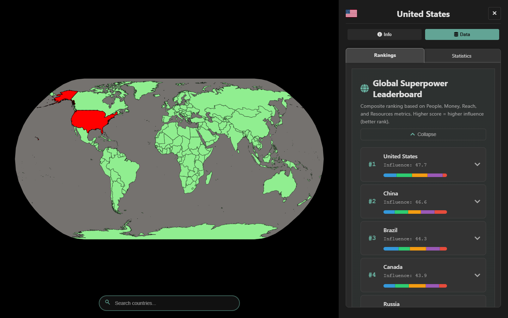

# Global Information Portal

An interactive world map that turns the CIA World Factbook into something you can click through: pick a country, read its profile, and see how it ranks against every other country on population, economy, military reach, energy, and quality of life.

It is built for students, teachers, travelers, and anyone who wants to compare countries without opening a dozen tabs. All data comes from the [CIA World Factbook](https://www.cia.gov/the-world-factbook/) through the community-maintained [factbook/factbook.json](https://github.com/factbook/factbook.json) mirror, fetched directly in the browser. There is no backend, no database, and no API key.

**Live site:** https://kcpatt27.github.io/global-info-portal/

## Screenshots

| Map and country profile | Global Superpower Leaderboard |
|---|---|
|  |  |


## What it does

- **Click a country** on the D3 map to load its profile: flag, quick stats, and a background summary.
- **Statistics tab**: every Factbook category for that country (Geography, People and Society, Environment, Government, Economy, Energy, Communications, Transportation, Military, and more), with search and per-statistic global rank.
- **Rankings tab**: a composite influence score built from five categories (People, Money, Reach, Resources, Quality), a color bar showing what drives the score, and a spider chart per country.
- **Progressive loading**: priority countries (G20, NATO, BRICS, EU) load first, the rest fill in from a background queue and are cached in `localStorage`.
- **Mobile**: the info panel becomes a bottom sheet with touch zoom and pan on the map.

Scores use fixed reference scales, so a country's score does not change depending on which other countries happen to be loaded.

## Install, build, run, deploy

Requires Node.js 18 or newer and npm (tested on Node 24).

```bash
git clone https://github.com/kcpatt27/global-info-portal.git
cd global-info-portal
npm install
```

Build for production into `dist/`:

```bash
npm run build
```

Run it locally. The app is a static site, so serve the repository root:

```bash
npx serve .
# prints the URL, default http://localhost:3000
```

Any static file server works, for example `python -m http.server 8000`. Serve the repository root, not `dist/`, because `index.html` references the bundles as `dist/main.js` and `dist/styles.css`.

`npm start` (Webpack Dev Server) is not wired up for this layout yet: it serves from `public/` and does not pick up the root `index.html`. Use the static server above until that is fixed.

Other scripts:

```bash
npm run build:dev       # unminified build
npm run build:analyze   # production build plus bundle analyzer
npm test                # Jest (no test suite yet)
```

Deploy: GitHub Pages serves the repository root, so `index.html` plus the committed `dist/` folder is the whole site.

```bash
npm run build
git add dist index.html
git commit -m "build: rebuild dist"
git push
```

To host it yourself, build and serve the repository root with any static file server. `dist/` must stay next to `index.html` because the bundles are referenced as `dist/main.js`, `dist/styles.css`, and so on.

## How the data flows

```
map click -> country code -> factbook.json (raw.githubusercontent.com)
          -> parse and normalize -> cache -> state -> panels and charts
```

Country files are organized by region folder and keyed by FIPS code, which the app maps to ISO alpha-2 for flags and lookups. Requests have timeouts and fallback URL patterns; a failed fetch shows "Data unavailable" instead of breaking the panel.

Full component breakdown, module responsibilities, and failure modes: [ARCHITECTURE.md](ARCHITECTURE.md).

## Project docs

- [ARCHITECTURE.md](ARCHITECTURE.md): system design, modules, data flow, failure modes.
- [ROADMAP.md](ROADMAP.md): what is done, what is next, known risks.
- [PROJECT_SPECS.md](PROJECT_SPECS.md): original specification.
- [docs/key-metrics.md](docs/key-metrics.md): build size, load times, commit counts, and how they were measured.
- [docs/retrospective.md](docs/retrospective.md): what worked, what did not, and what I would change.
- [docs/living-doc-of-build-process.md](docs/living-doc-of-build-process.md): running log of the build.
- [docs/summary-for-career.md](docs/summary-for-career.md): the project written up as a portfolio piece.

## Tech stack

Vanilla JavaScript (ES modules), HTML5, and modular CSS. D3 v5.6.0 and TopoJSON v3.0.2 for the map and charts, loaded from unpkg. Webpack 5 with Babel and PostCSS for bundling, code splitting, and gzip output. No framework; `core-js` supplies the polyfills.

## Contributing

Issues and pull requests are welcome. Keep the existing structure: ES modules under `js/`, component CSS under `css-styles/`, mobile-first styles, and no new framework. Run `npm run build` before opening a PR so `dist/` stays in sync.

## License

This project is not licensed for reuse. All rights reserved. If you want to use the code, open an issue and ask.

**Data attribution:** country data is from the CIA World Factbook, a work of the U.S. Government and therefore in the public domain. The JSON mirror is maintained by [factbook/factbook.json](https://github.com/factbook/factbook.json). Country boundary geometry comes from the TopoJSON world atlas. The CIA does not endorse this project.

**Third-party libraries:** D3.js and TopoJSON (BSD 3-Clause), Font Awesome 5 (icons CC BY 4.0, fonts SIL OFL 1.1), Flag Icon CSS (MIT).

## How it was built

Solo project, built with Cursor as an editor and pair programmer. The map interactions, data fetching, scoring model, caching strategy, and UI decisions are mine; the AI contributed scaffolding, refactors, and documentation drafts. [docs/retrospective.md](docs/retrospective.md) covers what that split actually looked like in practice.
