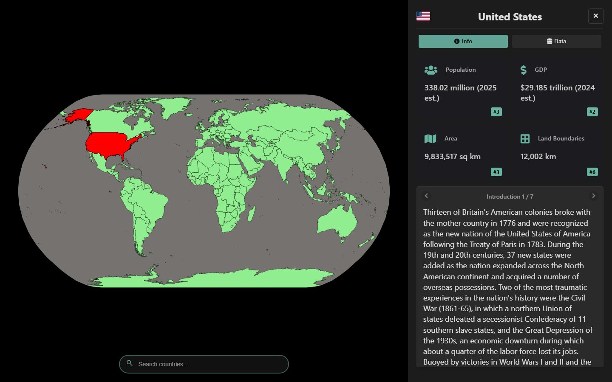
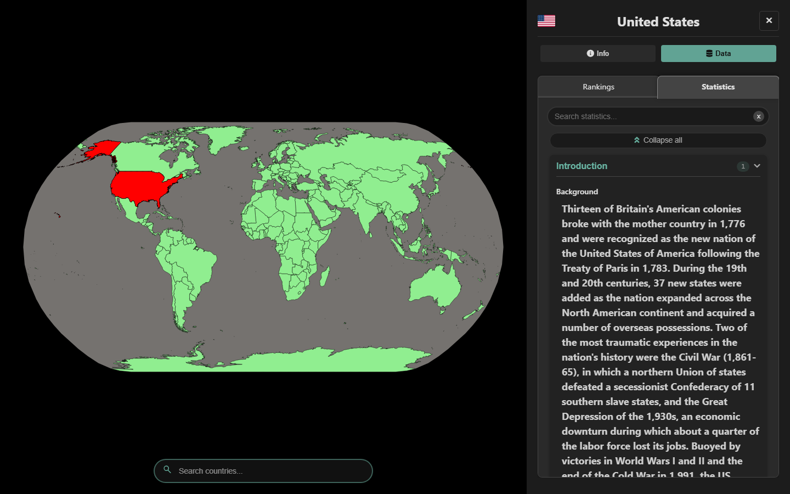

# Global Information Portal

An interactive world map of CIA World Factbook data: click any country to read its statistics, compare it against global rankings, and see where it lands on a composite influence leaderboard.

**Live site:** https://kcpatt27.github.io/global-info-portal/

No account, API key, or backend. The browser fetches public Factbook JSON directly.

---

## Screenshots

| Country info | Rankings |
|---|---|
|  |  |



All three are 1440x900 captures of the current UI.

What you can do:

- Click a country to see flag, population, GDP, area, land boundaries, and a cycling background summary.
- Open the **Data** panel and switch between **Rankings** and **Statistics**.
- Search countries from the map, or search statistics inside the Statistics tab.
- Expand a leaderboard entry for its category breakdown and spider chart.

---

## How the data pipeline works

Everything runs in the browser. There is no server, database, or build-time data step.

1. **Map geometry.** `js/map.js` fetches two files from the `kcpatt27/world-atlas-2-world-factbook` repository: a TopoJSON world atlas (`world atlas json 50m`) and a TSV lookup that maps map feature IDs to country names and codes. D3 converts the TopoJSON to GeoJSON and renders one `path.country` per feature, keyed by FIPS code.

2. **Country selection.** A click calls `selectCountry` in `js/map.js`, which highlights the path and fires `onCountrySelect`. `handleCountrySelect` in `js/main.js` resolves the Factbook code (the map uses FIPS, the Factbook files use their own codes) and starts the fetch.

3. **Fetch.** `fetchCountryData` in `js/utils/dataFetcher.js` requests:

   ```
   https://raw.githubusercontent.com/factbook/factbook.json/master/{folder}/{code}.json
   ```

   Each request has a 10 second `AbortController` timeout, falls back to a `factbook/{folder}/{code}.json` path if the first URL fails, and deduplicates in-flight requests for the same country.

4. **Parse and render.** `processText` strips HTML from Factbook strings, `extractDataPoint` walks dot-notation paths, and the `sanitizer` in `js/utils/dataSanitizer.js` cleans values before they reach the DOM. The raw country object is cached in `countryDataCache`, the info panel and background text update, and the Statistics tab builds its category tree from the same object.

5. **Leaderboard pre-cache.** On load, `preCacheG20Countries` in `js/utils/globalPreCache.js` fetches 50 priority countries in batches of 5 with a 100 ms gap, extracts 82 metrics per country through `js/utils/leaderboardMetrics.js`, and stores only those metrics in `localStorage` under `global_leaderboard_cache` (cache version 15, 7 day expiry). `progressiveCacheSecondary` loads the remaining countries in the background, and the **Load All Countries** button calls `loadAllCountries`.

6. **Scoring.** `js/utils/leaderboardScoring.js` normalizes each metric against a fixed reference scale, sums the normalized scores within five categories (People, Money, Reach, Resources, Quality), then sums the category totals into the influence scale. Fixed scales mean a country's score does not change when other countries load.

The only network dependencies at runtime are the Factbook JSON, the world atlas files, and the CDN copies of D3, TopoJSON, Font Awesome, and Flag Icon CSS referenced by `index.html`.

---

## Build and deploy

Requires Node.js and npm. The commands below were tested with Node.js 24.18.0 and npm 11.16.0.

```bash
git clone https://github.com/kcpatt27/global-info-portal.git
cd global-info-portal
npm install
npm run build
npx --yes http-server . -p 8080
```

Open http://localhost:8080/. Serve the repository root, not `dist/`, because `index.html` lives at the root and loads `dist/` assets by relative path. If port 8080 is taken, pass another one, for example `-p 8081`.

`npm start` runs `webpack serve`, which compiles the bundles but does not serve `index.html` (no `devServer.static` is configured, so it serves from a `public/` directory that does not exist). It is not a usable preview on its own. Use the static server above.

### Deploy to GitHub Pages

GitHub Pages is configured to build from the `main` branch, repository root. Deployment is a production build committed with the generated `dist/` output:

```bash
npm run build
git add index.html dist
git commit -m "build: rebuild dist for GitHub Pages"
git push origin main
```

The push triggers the `pages-build-deployment` workflow. The site is live at https://kcpatt27.github.io/global-info-portal/ once that run finishes.

`npm run deploy` runs a production build and then prints a reminder; it does not publish anything.

---

## Where the docs fit

| File | What it covers |
|---|---|
| [ARCHITECTURE.md](ARCHITECTURE.md) | Module layout, state flow, panel system, and design decisions |
| [ROADMAP.md](ROADMAP.md) | Completed milestones and the next phase |
| [docs/key-metrics.md](docs/key-metrics.md) | Commit counts, bundle sizes, and measured performance numbers |
| [docs/retrospective.md](docs/retrospective.md) | Phase-by-phase project retrospective |
| [docs/living-doc-of-build-process.md](docs/living-doc-of-build-process.md) | Narrative build log, from the first API search onward |
| [docs/summary-for-career.md](docs/summary-for-career.md) | Career-facing project summary |
| [docs/gip-RESUME_DATA_POINTS.md](docs/gip-RESUME_DATA_POINTS.md) | Resume-ready metrics and scope statements |
| [docs/feature-planning/](docs/feature-planning/) | Mobile CSS, mobile navigation, and rankings design notes |
| [docs/fix-refactor-planning/](docs/fix-refactor-planning/) | JavaScript refactor plan and leaderboard metric analysis |

The README stays short on purpose. Architecture detail belongs in `ARCHITECTURE.md`, status in `ROADMAP.md`, and measurements in `docs/key-metrics.md`.

---

## License and data attribution

This repository has no license file. All rights are reserved by the author; the code is public to read, not licensed for reuse.

Data attribution:

- **CIA World Factbook**: public domain as a U.S. Government work. Country JSON is read from the [factbook/factbook.json](https://github.com/factbook/factbook.json) mirror.
- **World atlas geometry**: TopoJSON and the country lookup TSV come from [kcpatt27/world-atlas-2-world-factbook](https://github.com/kcpatt27/world-atlas-2-world-factbook).
- **Libraries**: D3.js and TopoJSON (BSD 3-Clause), Font Awesome Free (icons CC BY 4.0, fonts SIL OFL 1.1), Flag Icon CSS (MIT).

The influence scores are a heuristic built for comparison and education, not an official index.
